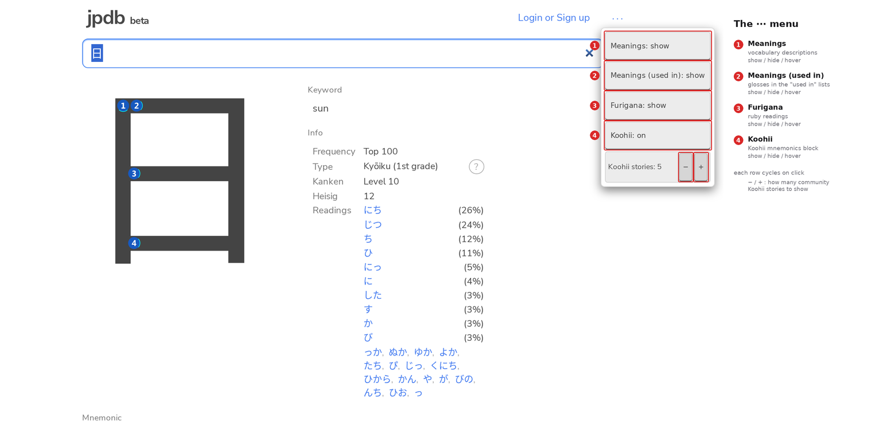
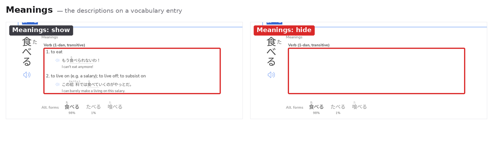
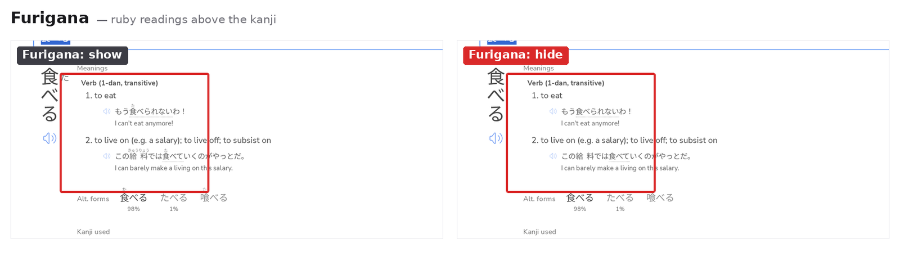
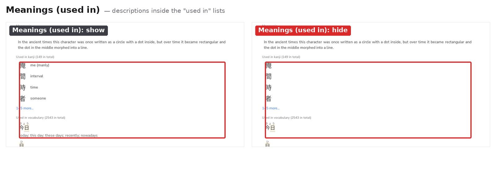

# jpdb+

A Tampermonkey userscript that puts a `···` menu on [jpdb.io](https://jpdb.io) and pulls
[Kanji Koohii](https://kanji.koohii.com) mnemonics onto kanji pages.

## Install

**Desktop** — with [Tampermonkey](https://www.tampermonkey.net/) or
[Violentmonkey](https://violentmonkey.github.io/) installed, open
[`jpdb-plus.user.js`](https://raw.githubusercontent.com/JasonHiew/jpdb-plus/main/jpdb-plus.user.js)
and accept the install prompt.

**iPhone / iPad** — the free [Userscripts](https://apps.apple.com/app/userscripts/id1463298887)
app (iOS 15.1+) runs these in Safari. Install it, open the same `.user.js` link in Safari, then
install from the extension's menu. See [below](#on-iphone-and-ipad) for what Safari changes.

## The menu

Four rows and a story count. Each row cycles **show → hide → hover** on click and remembers the
setting in `localStorage`.

### Meanings

The descriptions on a vocabulary entry: the senses and their example sentences. Hiding them
leaves the headword, the readings and the part of speech, so you can try to produce the meaning
before you look.

### Furigana

Every `rt` annotation on the page — the small reading above precisely the kanji you might not
know yet.

### Meanings (used in)

The English inside the "used in kanji" and "used in vocabulary" lists. A kanji page ends in
hundreds of related words; with the glosses hidden it reads as a list of shapes to recognise
rather than a wall of translations. The Japanese and the readings stay either way.

### Koohii

Kanji Koohii's stories for the current kanji, inserted under jpdb's own mnemonic section: your
favourites first, then community stories with author, date and star count, starrable without
leaving the page. Cached per kanji for a week; `refresh` refetches. The `−` / `+` row sets how
many community stories to show.

**This one needs a Koohii login, which is why there is no screenshot of it here.** Kanji Koohii
answers a logged-out request with a sign-in page and zero stories — the whole page, not just the
favourites — and jpdb+ reads that page through your browser's own cookies. So there is nothing to
configure and no token to paste, but with no Koohii session you get an empty list and only the
section header and `refresh` link. Log in once at kanji.koohii.com in the same browser and the
stories appear.

## Limits

- **It scrapes Koohii's HTML.** There is no API for those stories, so the parse depends on their
  current markup and will break if they redesign. Bug reports with the kanji and a screenshot are
  the fastest fix.
- **`hover` does nothing on touch.** There is no pointer to hover with, so on a phone use `hide`.

## On iPhone and iPad

The script runs unchanged in Safari through the Userscripts app. The `···` menu opens on tap and
closes when you tap elsewhere. A native Safari Web Extension with a toolbar popup would be a
better home for the settings; it is not built yet.

## Notes

Not affiliated with jpdb.io or Kanji Koohii. It only changes what your own browser renders and
only makes requests you would have made by opening those pages yourself.

MIT licensed. No build step: one file, no dependencies.
