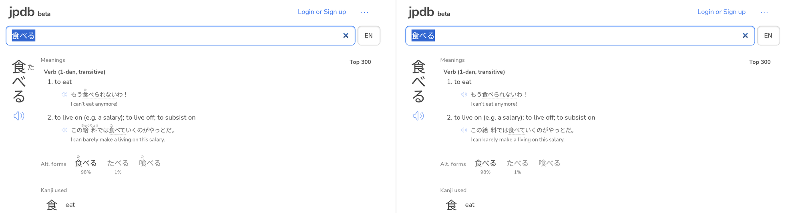

# jpdb+

A Tampermonkey userscript that puts a `···` menu on [jpdb.io](https://jpdb.io) and pulls
[Kanji Koohii](https://kanji.koohii.com) mnemonics onto kanji pages.

## Install

**Desktop** — with [Tampermonkey](https://www.tampermonkey.net/) or
[Violentmonkey](https://violentmonkey.github.io/) installed, open
[`jpdb+.user.js`](https://raw.githubusercontent.com/JasonHiew/jpdb-plus/main/jpdb%2B.user.js) and
accept the install prompt.

**iPhone / iPad** — the free [Userscripts](https://apps.apple.com/app/userscripts/id1463298887)
app (iOS 15.1+) runs these in Safari. Install it, open the same `.user.js` link in Safari, then
install from the extension's menu. See [below](#on-iphone-and-ipad) for what Safari changes.

## What it does

### Display toggles

jpdb always shows you the answer. Sometimes you want to make your brain produce it first — so
each piece of a page can be set to **show**, **hide**, or **hover**, cycling on click and
remembered in `localStorage`:

- **Meanings** — the descriptions on a vocabulary entry
- **Meanings (used in)** — descriptions inside the "used in vocabulary" and "used in kanji" lists
- **Furigana** — every `rt` ruby annotation on the page
- **Koohii** — the mnemonic block described below, on or off

`hover` hides the text until the pointer is over its container. That is the setting that makes a
page usable for self-testing while keeping the answer a flick away.

### Koohii mnemonics on kanji pages

Kanji Koohii's stories for the kanji you are looking at, inserted under jpdb's own mnemonic
section: your favourites first, then community stories, each with author, date and star count.
Stories can be starred from jpdb without leaving the page. The `−` / `+` row sets how many
community stories to show. Each kanji is cached for a week; `refresh` refetches it.

## Two things to know

**Koohii needs you logged in.** The script reads the Koohii page as you, through your browser's
own cookies, so there is no account to configure and no token to paste — but with no Koohii
session the story list comes back empty and only the section header and `refresh` link appear.
Log in to kanji.koohii.com once in the same browser.

**It scrapes Koohii's HTML.** There is no API for those stories, so the parse depends on their
current markup and will break if they redesign the page. Bug reports with the kanji and a
screenshot are the fastest fix.

## On iPhone and iPad

The script runs unchanged in Safari through the Userscripts app, with two differences worth
knowing before you install it there:

- `hover` is a no-op on touch: there is no pointer to hover with. Use `hide` on mobile.
- The `···` menu opens on tap and closes when you tap elsewhere.

A native Safari Web Extension with a proper toolbar popup is the better long-term home for the
settings. It is not built yet.

## Notes

Not affiliated with jpdb.io or Kanji Koohii. It only changes what your own browser renders and
only sends requests you would have made by opening those pages yourself.

MIT licensed. No build step: one file, no dependencies.
